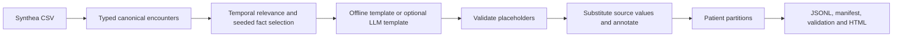

# ClinicalNoteForge

**An auditable pipeline that transforms structured synthetic EHR records into grounded,
automatically labeled clinical notes for healthcare NLP and model fine-tuning.**

ClinicalNoteForge converts structured synthetic longitudinal EHRs into clinical NLP training
datasets. Synthea records remain authoritative; template or controlled LLM renderers express
selected facts through placeholders. The pipeline preserves exact annotations, extraction
targets, provenance, validation evidence and patient-level ML partitions.

**Synthetic data only. Not intended for clinical use. No claim of clinical validation,
regulatory compliance, HIPAA certification, or suitability for patient care.**



For example, a structured observation `Hemoglobin A1c / 4548-4 / 8.20 / %` becomes
`Hemoglobin A1c: 8.20 %`, with exact spans and the same expressed values in its JSON target.
The code `4548-4` remains source metadata, rather than a value the extraction model must predict.
Nothing asks the renderer to invent or recalculate a measurement.

## Problem

Synthea generates longitudinal synthetic EHRs. This project starts at its CSV exports; it does
not simulate patients. It converts encounter-relevant structured facts into paired text and
extraction targets while retaining source lineage, patient separation and validation evidence.

## Why not just use Synthea's note exporter?

Synthea already has a useful [FreeMarker-based clinical-note exporter](https://github.com/synthetichealth/synthea/blob/master/src/main/java/org/mitre/synthea/export/ClinicalNoteExporter.java).
ClinicalNoteForge adds an ML dataset engineering layer over exported CSVs: explicit note/JSON
training pairs, exact source-grounded spans, patient-safe partitions, provenance, manifests and
dataset validation, with optional controlled LLM linguistic variation. Synthea's exporter is
prior art and complementary infrastructure; generating text alone is not this project's contribution.

## Design

- Strongly typed Pydantic v2 models replace raw CSV rows at the ingestion boundary.
- Conditions and medications are selected only when active at encounter start. Observations and
  procedures must link to that encounter; unlinked observations are excluded.
- A configurable, seeded selection stage records exactly the allowed facts.
- Both renderers use short per-note aliases such as `[[COND_1]]` and `[[OBS_1_VALUE]]`.
  The LLM receives semantic values and entity types for context, but must express facts using
  placeholders. Application code inserts descriptions, values, units and encounter context.
  Permanent fact IDs and source codes remain metadata; codes are not appended to ordinary prose.
- Three outpatient styles: concise progress, SOAP-style, and narrative follow-up. Missing
  symptoms, plans, dosage instructions and clinical interpretations are never filled in.
- All eligible patients are partitioned before sampling. A limit uses seeded patient/encounter
  hash ranking and round-robin selection: one encounter per patient before a second, rather
  than a chronological prefix. This broadens patient coverage without claiming statistical
  representativeness or forcing every small sample to contain all three splits.

## Architecture

The package keeps responsibilities in a small set of modules:

| Module | Responsibility |
| --- | --- |
| `models.py`, `config.py` | Versioned contracts and non-secret TOML settings |
| `ingestion.py` | CSV validation, reference checks, normalization, adapter protocol |
| `selection.py` | Temporal relevance, seeded subset/style choice, patient partitioning |
| `rendering.py` | Renderer protocol, offline/LLM providers, placeholder checks and substitution |
| `validation.py` | Reconstructed spans/targets, identity, integrity and leakage checks |
| `pipeline.py` | Staged build, export and manifest |
| `reporting.py`, `cli.py` | Measured statistics, escaped static HTML and CLI |

See [architecture and contracts](docs/architecture.md) for temporal semantics, provenance and
failure behavior. An ingestion protocol permits a future FHIR adapter without changing renderers.

## Quick Start

Python 3.12 or newer is required. No API key, Java, Docker or Synthea installation is needed.

```bash
git clone https://github.com/tristan-hooper/clinical-note-forge.git clinical-note-forge
cd clinical-note-forge
python -m venv .venv
```

Activate with `source .venv/bin/activate` on Linux/macOS, or
`.\.venv\Scripts\Activate.ps1` in PowerShell. Then:

```bash
pip install -e ".[dev]"
clinicalnoteforge inspect --input tests/fixtures/synthea
clinicalnoteforge build --input tests/fixtures/synthea --output output/final-v2 --renderer template --seed 42
clinicalnoteforge validate output/final-v2
clinicalnoteforge report output/final-v2
pytest
```

Open `output/final-v2/samples/examples.html` in a browser. A checked-in
[sample report](examples/examples.html) and [complete example record](examples/record.json)
also show the verified fixture output. Rebuilds must use a **new output directory**; existing
artifacts are preserved. `validate` and `report` regenerate derived reports in place.

For your own **synthetic** Synthea export, point `--input` at its CSV directory:

```bash
clinicalnoteforge inspect --input /path/to/synthea/output/csv
clinicalnoteforge build --input /path/to/synthea/output/csv --output output/synthea-v2 --config configs/default.toml --limit 100
```

`patients.csv` and `encounters.csv` are required. Conditions, medications, observations and
procedures are loaded when present; missing optional tables produce warnings. Additional
columns and unrelated tables are tolerated. Malformed present tables fail clearly. Schema
compatibility was checked against the official exporter on October 1, 2026; the runtime still
validates columns rather than assuming a fixed Synthea file count.

### Configuration and optional LLM

`configs/default.toml` configures the seed, renderer, three styles and weights, split proportions,
selection fraction, retries, temperature, response limit and cache directory. Optional
`max_records` and `max_facts_per_group` bound a build. CLI options override matching TOML fields.
Relative cache paths resolve from the working directory. `.env.example` documents environment
variables; the program does **not** automatically load a `.env` file.

For an OpenAI-compatible Chat Completions provider, set `CLINICALNOTEFORGE_API_KEY` (or
`OPENAI_API_KEY`) in your environment. Optionally set `CLINICALNOTEFORGE_BASE_URL`, then:

```bash
clinicalnoteforge build --input tests/fixtures/synthea --output output/llm-v2 --renderer llm --model YOUR_COMPATIBLE_MODEL
```

The endpoint must support text Chat Completions, `temperature` and `max_tokens`. HTTPS is
required except for loopback HTTP servers. Credentials are never written into artifacts.
Selected semantic values, short aliases and entity types reach the provider; unrelated patient
attributes, source codes and permanent hash IDs are not included in the prompt. The model is
explicitly prohibited from independently writing or paraphrasing factual values. Required
placeholders, numeric-literal checks and exact known-value literal checks reject detectable violations.
Accepted templates are cached with provider, model, prompt, settings, seed and source context
in the cache key. Invalid templates are rejected and retried up to the configured count.
Online calls are not inherently reproducible. Default `template` operation always works without
credentials; explicitly requesting `llm` without a key/model fails with a clear error.

## Dataset Format

One UTF-8 JSON object per line, schema version **2.0**. The authoritative JSON Schema is
[examples/record.schema.json](examples/record.schema.json), generated from the Pydantic contract.

| Field | Meaning |
| --- | --- |
| `record_id`, `patient_id`, `encounter_id`, `split` | Stable record content identity and grouping |
| `note.style`, `note.text` | Extraction model input |
| `target` | Conditions, medications, observations and procedures actually expressed |
| `selected_facts` | Allowed normalized facts, source codes, temporal fields and row provenance |
| `annotations` | Exact half-open character spans and source table/row/code |
| `source` | Synthetic source context, patient/encounter IDs and provenance |
| `generation` | Renderer, model/provider, prompt version, seed, settings, template and failure history |
| `validation` | Per-record deterministic structural result |

Schema 2.0 removes codes from the primary `target` and uses short annotation placeholders.
Condition metadata also retains a resolved originating-encounter start when available. This is
a deliberate breaking contract change: schema 1.0 artifacts are rejected by the current validator;
rebuild from source into a new directory. Source codes remain in `selected_facts` and annotation
`source_code`; Project 2 should train on `target`, not the provenance payload.

Observation `value` is a **string**, including numeric values such as `"8.20"`. This preserves
source precision, formatting and text observations. `unit` is a string; an absent source unit
remains `""`. Offsets use Python Unicode code points, not UTF-8 bytes or JavaScript UTF-16 units.
Repeated placeholders produce separate annotations; targets contain one entry per selected
source fact. Duplicate source rows remain distinct through row-based IDs.

Each build contains:

```text
train.jsonl  validation.jsonl  test.jsonl
manifest.json  rejected.jsonl
validation_report.json  statistics.json
samples/examples.html
```

Project 2 should consume the three split JSONL files directly: `note.text` as input and `target`
as supervised JSON output. Retain the split names and provenance; do not repartition by note.
The fixture is a smoke-test dataset, not enough data to train a useful extraction model.

## Example

This actual fixture-generated progress note illustrates source-only factual content:

```text
Progress note
Encounter for check up on 2024-01-10.
62-year-old patient; sex recorded as F.
Dx: Type 2 diabetes mellitus; Acute bronchitis.
Meds: Metformin hydrochloride 500 MG Oral Tablet.
Obs: Body weight: 61.00 kg; Hemoglobin A1c: 8.20 %.
```

Its observation target includes
`{"description":"Hemoglobin A1c","value":"8.20","unit":"%"}`.
Medication strength is part of the source description, not an invented prescribed dose or frequency.

## Validation

The seed-42 offline fixture build was executed and reloaded successfully:

| Measurement | Actual result |
| --- | ---: |
| Source patients / encounters | 10 / 21 |
| Eligible outpatient encounters / accepted records | 20 / 20 |
| Rejected records / patient leakage | 0 / 0 |
| Train / validation / test records | 16 / 2 / 2 |
| Concise / SOAP / narrative records | 10 / 6 / 4 |
| Mean / median note length in code points | 269.95 / 264 |
| Placeholder / missing fact / offset failures | 0 / 0 / 0 |
| Generation acceptance rate | 100% |

The [official latest CSV sample](https://synthetichealth.github.io/downloads.html) was also
downloaded and exercised: 108 patient rows, 5,571 encounters, 4,960 outpatient-eligible encounters.
A seed-42 limit-100 build accepted all 100 notes from 100 distinct patients, with 79/11/10 records
by split and zero leakage or validation failures. All 2,355 selected source facts were compared
back to normalized input: 720 conditions, 220 medications, 1,171 observations and 244 procedures.
See [verification evidence and commands](docs/verification.md). The download and its generated
notes are ignored local artifacts, not redistributed repository fixtures.

These are structural dataset measurements, **not clinical accuracy**. Reports also include code
frequencies and issue occurrences from rejected/retried generations. Limits can leave a split
empty; patient proportions do not guarantee identical note proportions.

`validate` checks schema, placeholder coverage, authoritative substitution, exact annotations,
target equality, active facts, record/source identities, seeded partitions, duplicate records,
file checksums and counts. Leakage always fails validation. Exit codes: `0` for success,
`1` for input/artifact errors, `2` for a completed build with generation rejections. Rejected
records are never placed in training files. A structurally valid artifact can contain
rejections; read the acceptance rate before using it.

## Testing

```bash
ruff check .
ruff format --check .
pytest -q
```

The verified suite has **75 passing tests**; lint and formatting pass. Tests cover malformed
schemas/references, optional tables, temporal boundaries, numeric precision, Unicode/repeated
spans, patient splits, export/reload, corruption, CLI and mocked LLM/HTTP behavior. GitHub Actions
runs installation, Ruff, pytest and the offline demo without secrets.

## Limitations

- Deterministic validation cannot detect every unsupported clinical assertion in LLM connective
  prose, including spelled-out numbers, negation or causal claims. Review LLM-generated language.
- Placeholder substitution protects inserted values, not clinical plausibility or representativeness.
- Outpatient styles only. No FHIR ingestion, clinical interpretation, inferred prescription details,
  unlinked observation matching, fine-tuning, retrieval or clinical application.
- The adapter reads supported tables into memory. It indexes by patient, but scans that patient's
  history per encounter; large exports may need streaming and interval indexes.
- Source row numbers contribute to fact IDs; row reordering changes IDs. Artifact checksums detect
  accidental changes, not deliberate rewriting of both data and manifests. Revalidation uses saved
  source facts, not independent verification against the original CSVs.
- Fixtures are entirely fabricated and intentionally small. The official CSV sample was exercised;
  Synthea itself was not run. No compatible credential was available, so live LLM calls were not
  exercised. Semantic prompt construction, compatible HTTP and controlled generation are tested
  through deterministic/mocked integrations.

## Responsible Use

Use synthetic inputs only. Intended for software development, NLP experimentation and
educational/research portfolio use. Generated notes have not been clinically validated and are
not representative of all real clinical documentation. Do not use them for patient care,
diagnosis, clinical decision support or claims of regulatory compliance. See [DATA_CARD.md](DATA_CARD.md).

## Project Roadmap

This is Project 1. Its versioned note/JSON pairs are intended to feed a subsequent **ClinicalExtract**
project that fine-tunes a small extraction model, followed by **ClinicalBench** evaluation,
**ClinicalSearch** retrieval and a possible integrated workbench. These are planned projects;
this repository does not claim they exist. FHIR and richer styles remain future extensions.

## References

- [Synthea](https://github.com/synthetichealth/synthea),
  [official CSV column definitions](https://github.com/synthetichealth/synthea/blob/master/src/main/java/org/mitre/synthea/export/CSVConstants.java),
  and [CSV exporter semantics](https://github.com/synthetichealth/synthea/blob/master/src/main/java/org/mitre/synthea/export/CSVExporter.java).
- [NHS England synthetic_clinical_notes](https://github.com/nhsengland/synthetic_clinical_notes)
  was consulted as related synthetic-note work. ClinicalNoteForge independently implements a
  source-grounded placeholder pipeline; no implementation or dataset was copied.

Original code and repository-created fixtures are MIT licensed. Dependencies and externally
generated Synthea datasets retain their own licenses and applicable usage conditions.
